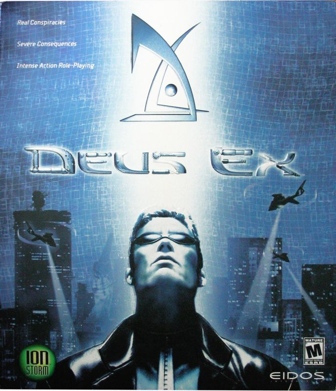
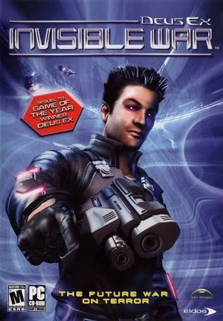

# deus-ex-invisible-war-deus-ex-2000
## Deus Ex: Invisible War - Deus Ex (2000)
A remake of Deus Ex (2000), rebuilt using the Deus Ex: Invisible War engine.

## Github Treeview
[https://treegit.macosxjs.com/?url=igiteam/deus-ex-invisible-war-deus-ex-2000](https://treegit.macosxjs.com/?url=igiteam/deus-ex-invisible-war-deus-ex-2000)

## Github Tree Api Direct JSON
[https://api.github.com/repos/igiteam/deus-ex-invisible-war-deus-ex-2000/git/trees/main?recursive=1](https://api.github.com/repos/igiteam/deus-ex-invisible-war-deus-ex-2000/git/trees/main?recursive=1)

## Deus Ex 2000 Webassembly
[https://jarmitage99.itch.io/opende](https://jarmitage99.itch.io/opende)

## Base Gameplay

## WS11WineCX20.0.4 (macOS Big Sur 32-bit)

[WS11WineCX20.0.4.tar.7z](https://github.com/vitor251093/porting-kit-engines/releases/download/wineskin/WS11WineCX20.0.4.tar.7z)

## Reference Links

---

# OpenDE

An open-source reimplementation of the Deus Ex engine and UnrealEd. It runs
the original game's UnrealScript bytecode from the shipped `.u` packages on a
new C++ engine built on SDL2 and OpenGL 3.3.

The original game data is required and is not included.

## Features

- Runs natively on Linux, Windows, macOS and in the browser
- Widescreen support with Hor+ field of view
- imgui-based editor
- Anisotropic filtering, trilinear filtering
- MSAA and FXAA
- Smooth lighting: bicubic filtering of lightmaps
- Detail textures visible at longer distances

## Requirements

Debian/Ubuntu with:

    $ sudo apt install build-essential cmake pkg-config libx11-dev libxext-dev libxrandr-dev libxcursor-dev libxi-dev libxss-dev libxkbcommon-dev libgl-dev libegl-dev libasound2-dev libpulse-dev libwayland-dev wayland-protocols libdecor-0-dev libssl-dev

Every other library dependency is vendored in `vendor/` and built with the project.

## Game data

Copy the contents of an installed Deus Ex (GOTY 1112fm) into `game-data/`, so
that `game-data/System`, `game-data/Maps`, `game-data/Textures`,
`game-data/Sounds` and `game-data/Music` exist. Another location can be given
at configure time with `-DDEUSEX_GAME_DATA=/path/to/deusex`.

The Deus Ex demo (version 1002f) works too, for example
`DEUSEX_GAME_DATA=demo-data build/bin/deusex`.

At runtime the game and the editor look for the data in this order: the
`DEUSEX_GAME_DATA` environment variable, a `game-data` directory next to the
executable (next to the AppImage file for AppImage builds), the Steam install
of Deus Ex (`steamapps/common/Deus Ex` in the default Steam directories and
their library folders), and finally the path given at configure time.

## Building

    $ cmake -S . -B build -DCMAKE_BUILD_TYPE=Release
    $ cmake --build build -j"$(nproc)"

Options:

- `-DSKIP_QA=ON` skips clang-format during the build.
- `-DSKIP_UT=ON` skips building the unit tests.

`scripts/check-debian.sh` builds the project in clean Debian 12 and Debian 13
containers with Docker.

### Windows

Windows builds are cross-compiled with MinGW:

    $ cmake -S . -B build-mingw -DCMAKE_TOOLCHAIN_FILE=cmake/mingw-w64-toolchain.cmake
    $ cmake --build build-mingw -j"$(nproc)"

## Browser builds

Requires Emscripten and WebGL 2. The game data given at configure time is
packaged into `index.data`, without the Windows binaries:

    $ emcmake cmake -S . -B build-web -DCMAKE_BUILD_TYPE=Release -DSKIP_UT=ON -DDEUSEX_GAME_DATA="$PWD/demo-data"
    $ cmake --build build-web --target deusex -j"$(nproc)"
    $ python3 -m http.server -d build-web/bin 8000

Then open `http://localhost:8000/`. The game data is LZ4 compressed
and cached in IndexedDB after the first download, together with settings
and saved games.

## Running

    $ build/bin/deusex

This starts at the title screen with the main menu. You can also specify a
map to be loaded `build/bin/deusex 01_NYC_UNATCOIsland`, or a path
to a `.dx` file.

Controls, settings and saves live in `~/.local/share/deusex` (`%APPDATA%\deusex`
on Windows): `DeusEx.ini` and `User.ini` are read from there when present
and otherwise from the game `System` directory, changed settings are
written there, and saved games are in `Save/`. The game data directory is
never written to. Key bindings are the original ones from `User.ini`, for
example keypad `+` for QuickSave and keypad `/` for QuickLoad.

## Multiplayer

To host, open Multiplayer in the main menu, pick LAN Game or Internet Game,
then Host Game. To join, type the host's address (`192.168.1.20` or
`192.168.1.20:7790`) into the IP Address field and press Join Game. The LAN
screen lists games on the local network.

Wont work with the original clients, OpenDE uses a new protocol. There is no
master server either so the Internet list stays empty.

From the CLI:

    $ build/bin/deusex "DXMP_Smuggler?game=DeusEx.DeathMatchGame?listen?Bots=4?Speed=150"
    $ build/bin/deusex 192.168.1.20:7790

Dedicated server:

    $ build/bin/deusex --server "DXMP_Smuggler?game=DeusEx.DeathMatchGame"

Servers use UDP port 7790, or `Port` in the `[URL]` section of `DeusEx.ini`,
or `--port`. LAN discovery uses UDP port 8777 and the port after the game
port.

## Editor

    $ build/bin/deused 01_NYC_UNATCOIsland

The editor is currently a work in progress. But it works!

## UnrealScript compiler

`ucc` exports and compiles UnrealScript, like the UCC that shipped with the
original Deus Ex SDK. Sources and compiled packages live in
`~/.local/share/deusex` and packages in `~/.local/share/deusex/System`
are loaded in place of the shipped ones with the same name.

To export the sources of a package:

    $ build/bin/ucc batchexport DeusEx.u class uc ~/.local/share/deusex/DeusEx/Classes

Compile:

    $ build/bin/ucc make

## Tests

    $ build/bin/unit-tests

Unit tests that need the game data are tagged `[data]`. You can run the ones
that dont need game data with:

    $ build/bin/unit-tests "~[data]"

The `[net]` tests run a dedicated server and two `--headless` clients as
separate processes, driven over stdin with `--control`. `DX_NET_LOSS`
(percent) and `DX_NET_LAG` (milliseconds) simulate a bad link.

## Thanks

This project would not be possible without the incredible work from these
legends:

- gildor
- dpJudas
- jmarshall
- AnthraX
- Marco888

## Dev Environment

**Official White Wii Remote With Nunchuk — Tested And Working — £14.99**
[https://www.ebay.co.uk/itm/800847189353](https://www.ebay.co.uk/itm/800847189353)

**Infrared Sensor Bar USB for Wii Emulator Remote Motion Detection Setup — £6.69**
[https://www.ebay.co.uk/itm/227423830875](https://www.ebay.co.uk/itm/227423830875)

**Apple MacBook Pro Retina 15in (2014) i7 2.8GHz 16GB 1TB SSD GT 750M — £120.30**
[https://www.ebay.co.uk/itm/800844561513](https://www.ebay.co.uk/itm/800844561513)

**WS11WineCX20.0.4 (Wine engine)**
[https://igiteam.github.io/wine_engines/](https://igiteam.github.io/wine_engines/)

**Official Genuine Sony PS3 PlayStation 3 DualShock 3 Wireless Controller Black — £19.99**
[https://www.ebay.co.uk/itm/840031043465](https://www.ebay.co.uk/itm/840031043465)

**Amazon Basics 4K HDMI Cable 3m — 18Gbps High Speed with Ethernet, 4K@60Hz, 2160p — £8.44**
[https://www.ebay.co.uk/itm/327352257557](https://www.ebay.co.uk/itm/327352257557)

**wiimote_nunchuk_macosx**
[https://github.com/igiteam/wiimote-nunchuk](https://github.com/igiteam/wiimote-nunchuk)

**xbox360_input_gui_py**
[https://github.com/igiteam/xbox360_input_gui_py](https://github.com/igiteam/xbox360_input_gui_py)

**logitec_mx_mouse_3_macos**
[https://github.com/igiteam/logitec_mx_mouse_3_macos](https://github.com/igiteam/logitec_mx_mouse_3_macos)

**igi1-macbook-3d-workstation**
[https://github.com/igiteam/igi1-macbook-3d-workstation](https://github.com/igiteam/igi1-macbook-3d-workstation)

---

